<div align="center">


</div>

---

## 👨‍💻 About Me

<table>
  <tr>
    <td width="60%" valign="middle">
      <h2>👋 Hi, I'm Ajim Mujawar</h2>
      <h3>Data Scientist | AI Engineer</h3>
      <p>🧠 Passionate about building intelligent, data-driven solutions using Machine Learning, Deep Learning, and Generative AI.</p>
      <p>📊 Focused on transforming raw data into actionable insights and developing AI-powered applications that solve real-world challenges.</p>
      <h3>🌱 Currently Exploring</h3>
      <p>
        🤖 LLMs, Generative AI &amp; AI Agents<br>
        🧠 Deep Learning, NLP &amp; Computer Vision<br>
        🔗 LangChain, RAG &amp; Model Context Protocol (MCP)<br>
        ⚙️ AI Automation, Azure &amp; MLOps
      </p>
      <h3>🎯 My Mission</h3>
      <p>To engineer scalable, reliable, and impactful AI solutions that solve real-world problems and deliver meaningful business value.</p>
    </td>
    <td width="40%" align="center" valign="middle">
      
    </td>
  </tr>
</table>

---


# 🚀 Tech Stack

<p align="center">


</p>

### Data Science

<p align="center">


</p>

---

# 📊 GitHub Stats

<p align="center">


</p>

---

# 🔥 GitHub Streak

<p align="center">


</p>


---

## 📈 Contribution Graph

<p align="center">
  
</p>

---

## 🏆 GitHub Trophies

<p align="center">
  
</p>

---


# 🐍 Snake Eating Contributions

<p align="center">


</p>

## 📂 Featured Projects

<p align="left">
  A collection of my projects in <b>Generative AI, Machine Learning, NLP, Computer Vision, RAG, AI Agents, and Workflow Automation</b>, focused on building intelligent solutions for real-world business problems.
</p>

<table>
  <thead>
    <tr>
      <th>🚀 Project</th>
      <th>🛠️ Technologies</th>
      <th>📝 Description</th>
    </tr>
  </thead>
  <tbody>
    <tr>
      <td>
        <b>🧠 Enterprise GenAI Customer Voice Intelligence &amp; Sentiment Analytics Platform</b>
      </td>
      <td>Python, GenAI, LLMs, NLP, RAG, Sentiment Analysis</td>
      <td>
        Built a GenAI-powered platform to analyze unstructured customer feedback, identify sentiment and recurring themes, and generate actionable business insights using LLMs.
      </td>
    </tr>
    <tr>
      <td>
        <b>🛡️ LLM Guardrails &amp; AI Safety Framework</b>
      </td>
      <td>Python, FastAPI, Gemini, Pytest, LLM Security</td>
      <td>
        Developed API-based guardrails to detect and mitigate prompt injection, jailbreak attempts, and sensitive information leakage, with automated tests to validate security controls.
      </td>
    </tr>
    <tr>
      <td>
        <b>🚦 AI Traffic Enforcement &amp; Smart Challan System</b>
      </td>
      <td>Python, Computer Vision, OpenCV, YOLO, OCR</td>
      <td>
        Developed an AI-powered traffic enforcement system to detect violations from images and video streams, identify vehicles, extract license plate information, and automate violation analysis.
      </td>
    </tr>
    <tr>
      <td>
        <b>📄 Enterprise PDF Document Intelligence &amp; RAG Chatbot</b>
      </td>
      <td>Python, LangChain, RAG, Hugging Face, ChromaDB, Groq, Gradio</td>
      <td>
        Built a PDF question-answering chatbot using document chunking, Hugging Face embeddings, ChromaDB vector search, and Groq LLM integration to generate context-aware, document-grounded responses.
      </td>
    </tr>
    <tr>
      <td>
        <b>🌐 MCP-Powered Multi-Server AI Assistant</b>
      </td>
      <td>Python, Model Context Protocol (MCP), Airbnb MCP, NotebookLM, Filesystem MCP</td>
      <td>
        Configured specialized MCP servers for accommodation search, knowledge retrieval, and filesystem operations. Designed an AI-assisted workflow for travel research, information synthesis, itinerary planning, and file generation.
      </td>
    </tr>
    <tr>
      <td>
        <b>⚙️ AI Automation Workflows with n8n</b>
      </td>
      <td>n8n, LLMs, APIs, AI Agents, Workflow Automation</td>
      <td>
        Designed AI-powered automation workflows integrating LLMs, APIs, and external services to streamline multi-step tasks, process information, and coordinate automated actions.
      </td>
    </tr>
    <tr>
      <td>
        <b>🏦 Bank Loan Default Risk Analysis</b>
      </td>
      <td>Python, Pandas, NumPy, Matplotlib, Seaborn, Exploratory Data Analysis</td>
      <td>
        Analyzed loan and customer financial data to identify default risk factors, uncover important patterns, and generate actionable insights to support credit risk assessment and data-driven lending decisions.
      </td>
    </tr>
  </tbody>
</table>

---

<h3>🎯 Core Areas of Expertise</h3>

<table>
  <tbody>
    <tr>
      <td>🤖 <b>Generative AI &amp; LLMs</b></td>
      <td>LLM Applications, RAG, Prompt Engineering, AI Safety</td>
    </tr>
    <tr>
      <td>🧠 <b>Machine Learning &amp; NLP</b></td>
      <td>Predictive Modeling, Sentiment Analysis, Classification, Clustering</td>
    </tr>
    <tr>
      <td>👁️ <b>Computer Vision</b></td>
      <td>OpenCV, YOLO, OCR, Image and Video Analysis</td>
    </tr>
    <tr>
      <td>🔗 <b>AI Agents &amp; Integrations</b></td>
      <td>MCP, Tool Integration, Multi-Server Workflows</td>
    </tr>
    <tr>
      <td>⚙️ <b>AI Automation</b></td>
      <td>n8n, API Integration, Workflow Orchestration</td>
    </tr>
    <tr>
      <td>📊 <b>Data Analytics</b></td>
      <td>Python, SQL, EDA, Data Visualization</td>
    </tr>
  </tbody>
</table>

---

<h3>💡 My Project Focus</h3>

<p>
  I build practical AI and data science solutions that combine <b>intelligent automation, data-driven insights, and LLM-powered applications</b> to address real-world business challenges.
</p>

## 📫 Connect With Me

<p align="center">

<a href="https://github.com/ajimmujawar44">

</a>
<a href="https://www.kaggle.com/azimmujawar" target="_blank">
  
</a>


<a href="https://www.linkedin.com/in/ajim-mujawar-data-scientist/">

</a>

<a href="mailto:ajimmujawar44@gmail.com">

</a>

</p>

---

## 📊 Kaggle

<p align="center">
<a href="https://www.kaggle.com/azimmujawar">

</a>
</p>

---
## 👀 Visitors

<p align="center">
  
</p>

## ⭐ Thanks for visiting my profile!

<div align="center">

<h3>
💙 <i>"Passionate about solving real-world problems through data, AI, and continuous innovation."</i>
</h3>

<p>
<b>— Ajim Mujawar</b>
</p>

</div>
```                                                    


</div>
